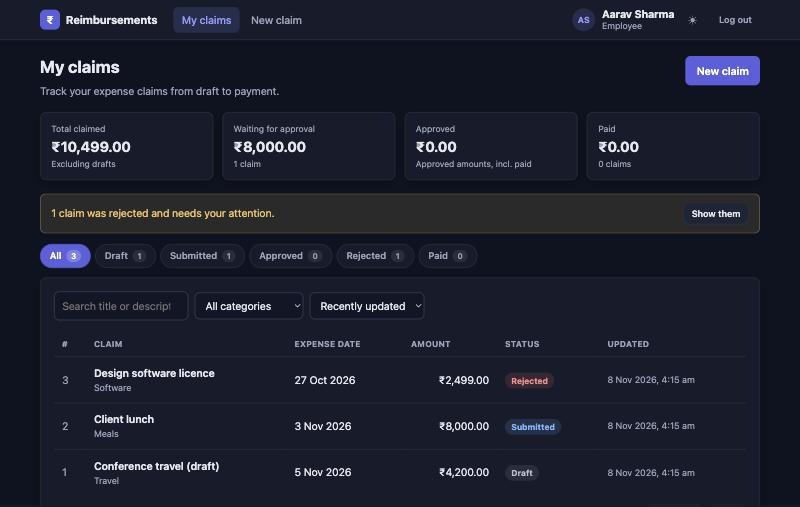
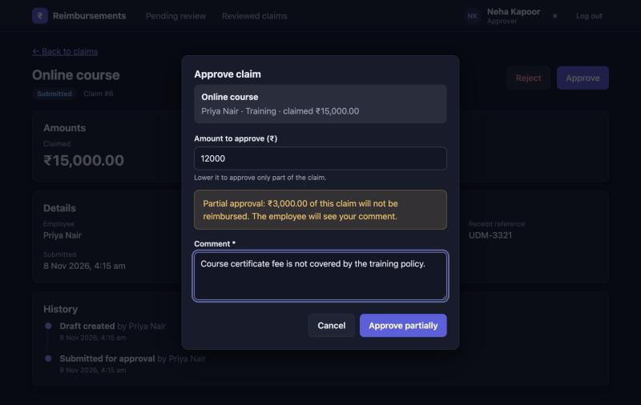
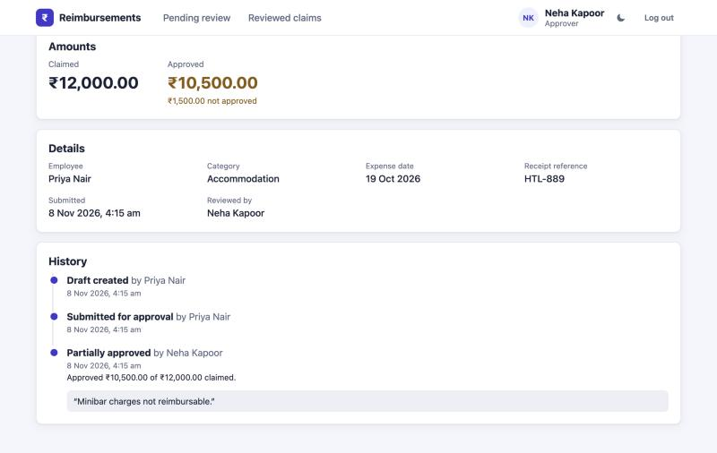

# Reimbursement Management System

[](https://github.com/gaurangt54/ght-reimbursement-system/actions/workflows/ci.yml)

Employees create expense claims and submit them. Approvers review them, approve them (in full or
partly) or reject them, and mark approved claims as paid. Every step is kept in a per-claim history.

**Flow:** create claim → submit → review → approve (full or partial) / reject → view outcome → mark as paid.
A rejected claim can be corrected and resubmitted. A submitted claim can be withdrawn back to draft before review.

| Layer | Stack |
|---|---|
| Backend | Python 3.10+, FastAPI, SQLAlchemy 2, Pydantic 2, PyJWT, bcrypt |
| Database | SQLite (WAL mode), one file: `backend/reimbursement.db` |
| Frontend | React 19, React Router 7, Vite 8 (plain CSS, no UI kit; light and dark themes, follows the OS until you pick one) |
| Tests | pytest (backend: 140 tests), Vitest + Testing Library (frontend: 57 tests) |

More detail: [docs/DATA_MODEL.md](docs/DATA_MODEL.md) (tables, ER and state diagrams, error codes),
[docs/DESIGN_DECISIONS.md](docs/DESIGN_DECISIONS.md) (concurrency, duplicates, auth, trade-offs) and
[docs/REQUIREMENTS_TRACEABILITY.md](docs/REQUIREMENTS_TRACEABILITY.md) (each requirement mapped to its code and tests).

## Screenshots

| Employee: my claims (dark) | Approver: partial approval |
|---|---|
|  |  |

**Claim history (light theme):** every step is recorded with who, when and the approver's comment.



## Prerequisites

- **Python 3.10 or newer** (tested on 3.10 and 3.12)
- **Node.js 22.12 or newer** (22.22+ to run the frontend tests) and npm
- Ports **8000** (API) and **5173** (web) free

## Setup and run

Use two terminals, both starting at the repository root.

**1. Backend** (http://127.0.0.1:8000, interactive API docs at `/docs`)

```bash
cd backend
python3 -m venv .venv
source .venv/bin/activate          # Windows: .venv\Scripts\activate
pip install -r requirements.txt
cp .env.example .env               # optional in dev; edit to change settings
uvicorn app.main:app --reload --port 8000
```

On first start the database is created and seeded with 5 demo users and a few claims in different states.

**2. Frontend** (http://localhost:5173)

```bash
cd frontend
npm ci
npm run dev
```

Open http://localhost:5173 and sign in with a demo account. The Vite dev server proxies `/api/*`
to the backend on port 8000, so no extra configuration is needed.

### Demo accounts

Created only when `SEED_DEMO_DATA=true` (the default). All of them use the password `Password@123`.
In dev builds the login page also lists them, and clicking one fills the form.

| Name | Email | Role |
|---|---|---|
| Aarav Sharma | `aarav@napho.test` | employee (has a draft, a pending claim and a rejected claim) |
| Priya Nair | `priya@napho.test` | employee (has partly approved, paid and pending claims) |
| Rohan Mehta | `rohan@napho.test` | employee (no claims) |
| Neha Kapoor | `neha@napho.test` | approver |
| Vikram Rao | `vikram@napho.test` | approver |

### Seed, reset and users

Run these from `backend/` with the virtualenv active:

```bash
python -m app.cli reset-db
```

Drops every table, recreates the schema and re-seeds the demo data (if `SEED_DEMO_DATA` is on).
**You need this once after pulling the auth changes**, because there are no migrations. The server
refuses to start on an old database and tells you to run it.

```bash
python -m app.cli create-user --name "Asha Iyer" --email asha@example.com --role approver
```

Creates a user and prompts for the password. Approvers can only be created this way or by the seed.

### Environment variables

All of them are optional in dev. Set them in the shell or in `backend/.env` (see [`backend/.env.example`](backend/.env.example)).

| Variable | Default | Purpose |
|---|---|---|
| `APP_ENV` | `dev` | Outside `dev`, `JWT_SECRET` is required (32+ characters) and startup fails without it. |
| `JWT_SECRET` | random per process (dev only) | HS256 signing key for access tokens. |
| `ACCESS_TOKEN_MINUTES` | `15` | Access-token lifetime. |
| `REFRESH_TOKEN_DAYS` | `7` | Refresh-token lifetime (sliding, rotated on every refresh). |
| `COOKIE_SECURE` | `false` | Set `true` when served over HTTPS (marks the refresh cookie `Secure`). |
| `SEED_DEMO_DATA` | `true` | Create the demo users and claims on first run. |
| `DEMO_PASSWORD` | `Password@123` | Password given to the demo users. |
| `DATABASE_URL` | `sqlite:///backend/reimbursement.db` | SQLAlchemy URL. |
| `CORS_ORIGINS` | `http://localhost:5173,http://127.0.0.1:5173` | Origins allowed to make credentialed requests. |
| `MAX_CLAIM_AMOUNT` / `RECEIPT_REQUIRED_ABOVE` / `MAX_EXPENSE_AGE_DAYS` | `100000.00` / `1000.00` / `90` | Policy limits. |

## Running the tests

```bash
cd backend && source .venv/bin/activate && python -m pytest       # 140 tests, ~2 s
```

```bash
cd frontend && npm test                                            # 57 tests, ~2 s
```

```bash
cd frontend && npm run lint && npm run build                       # lint + production build
```

Backend tests run against a throwaway SQLite file, so `reimbursement.db` is never touched. They cover
the full lifecycle, every invalid transition, validation boundaries, permissions, duplicate detection,
real multi-threaded races, queries and CSV export, and all of the authentication behaviour (token
tampering, expiry, `alg: none`, refresh rotation and reuse, logout, throttling, password change).
Frontend tests cover the validation and formatting helpers, `StatusBadge`, `ClaimsTable`,
`ApproveDialog`, the theme toggle, cross-tab sign-in/sign-out sync, and the API client's
401 → refresh → retry logic.

## Project structure

```
backend/
  app/
    main.py              FastAPI app, CORS, error handlers
    config.py            settings + policy constants (env / .env)
    database.py          engine (SQLite WAL, foreign keys, busy timeout), sessions
    models.py            users, refresh_tokens, claims, claim_events
    schemas.py           request/response models (Pydantic)
    security.py          bcrypt, JWT encode/decode, current_user, CSRF header check
    serializers.py       ORM -> response dicts (incl. allowed_actions)
    seed.py, cli.py      first-run seed; reset-db / create-user commands
    routers/             auth, users, claims, meta  (thin HTTP layer)
    services/
      rules.py           pure rules: policy checks, transitions, allowed_actions, fingerprint
      claims.py          use-cases; every state change = conditional UPDATE + event, one transaction
      queries.py         filtered/paginated lists, summary, CSV export
      auth.py            login, refresh rotation + reuse detection, logout, change password
      throttle.py        in-memory failed-login lockout
  tests/                 pytest suite
frontend/
  src/
    api/                 client.js (fetch wrapper, in-memory token, refresh+retry), api.js (endpoints)
    context/, hooks/     AuthProvider (session restore, cross-tab logout), toasts, useApi, URL filters
    components/          ClaimsTable, ClaimForm, dialogs, StatusBadge, Timeline, …
    pages/               Login, MyClaims, ClaimForm, ClaimDetail, ReviewQueue, ReviewedClaims
    lib/                 validation, formatting, error text, routes
docs/                    data model, design decisions, requirement traceability
.github/workflows/ci.yml  CI: backend tests + frontend lint/tests/build on every push
```

### API at a glance

| Method and path | Who | Purpose |
|---|---|---|
| `POST /api/auth/login` | anyone | Email + password → access token (body) + refresh cookie |
| `POST /api/auth/refresh` | cookie + `X-Requested-With` | Rotate the refresh token, get a new access token |
| `POST /api/auth/logout` | cookie + `X-Requested-With` | Revoke this login and clear the cookie |
| `GET /api/auth/me` | signed in | Current user |
| `POST /api/auth/change-password` | signed in | Change password; signs out every other device |
| `GET /api/users?role=employee` | approver | Employee list (filters) |
| `GET /api/meta` | anyone | Categories, currency, policy limits for form hints |
| `GET /api/claims` | signed in | List with `status`, `category`, `q`, `scope`, `employee_id`, `date_from`/`date_to`, `sort_by`/`order`, `page`/`page_size` |
| `GET /api/claims/summary` | signed in | Counts and totals for the dashboard cards |
| `GET /api/claims/export.csv` | approver | CSV of the filtered list |
| `POST /api/claims` · `PUT/DELETE /api/claims/{id}` | owner | Create, edit, delete a draft |
| `GET /api/claims/{id}` | owner or approver | Claim + full history + `allowed_actions` |
| `POST /api/claims/{id}/submit` · `/withdraw` | owner | Submit or resubmit; withdraw before review |
| `POST /api/claims/{id}/approve` · `/reject` · `/pay` | approver (not own claim) | Review and payment |

## Assumptions

- **Currency is INR.** Every claim is in INR (`currency` is stored per claim so more can be added). Amounts have 2 decimals.
- **Policy:**
  - a claim is at most **₹1,00,000**;
  - a **receipt reference** is required to *submit* a claim above **₹1,000** (drafts may be saved without one);
  - the expense date can't be in the future or more than **90 days** old (checked again on submit, because a draft can age).
- **Roles are fixed per user.** Employees create claims; approvers review them. Approvers don't file claims through the app. If an approver's claim exists anyway, they **cannot review their own claim** (enforced on the server, and no buttons are shown).
- **Any approver can review any submitted claim.** There are no reporting lines or approval chains.
- **Drafts are private.** Approvers never see drafts. Employees see only their own claims.
- **Partial approval** means approving `0 < amount < claimed`. A comment explaining the reduction is required. Rejection always needs a reason.
- **Rejected claims are corrected and resubmitted** as the same claim, with history kept and a resubmission counter. They are not deleted. Only drafts can be deleted (soft delete).
- **Payment is just a record:** who marked it paid, when, and an optional reference such as a UTR. No real payment integration.
- **Receipts are references** (an invoice number or a link), not uploaded files.

## Known limitations

- **No migrations.** The schema is created with `create_all`. After a schema change, run `python -m app.cli reset-db`. The app detects an old schema and refuses to start rather than misbehave.
- **SQLite allows one writer at a time.** Fine for this scale. Writes queue for up to 5 s (busy timeout). For many concurrent users, move to Postgres. The conditional-UPDATE design carries over.
- **Amounts are stored as** `REAL`**, rounded to 2 decimals.** All arithmetic and comparisons use `Decimal` in Python, and values are re-quantised on read, but the column itself is binary floating point. Integer paise would be stricter.
- **The login throttle is in memory.** It resets on restart and is per process (not shared across workers).
- **Duplicate detection is a heuristic:** same employee + currency + category + amount + date + title (case- and space-insensitive) among live claims. Two genuinely different expenses that match exactly are refused, and the employee must change the title.
- **CSV export is capped at 5,000 rows** per request. Narrow the filters to export more.
- **Withdrawn claims look deleted to approvers.** A withdrawn claim is a private draft again, so an approver who had it open gets "no longer available" (404) instead of "withdrawn".
- Access tokens are stateless. After logout or a password change, an already-issued access token keeps working until it expires (≤ 15 min), although the app discards it immediately. Deactivation and role changes apply at once.
- **One signed-in user per browser.** All tabs share the refresh cookie, so signing in as someone else in one tab switches the other open tabs to that user straight away (with a notice), and ends the previous user's session on the server. To try two roles side by side, use a private window or a second browser.
- There is no self-registration, password-reset email or change-password screen (the change-password API exists).
- In dev without `JWT_SECRET`, a backend restart invalidates access tokens. The app silently refreshes, so users don't notice.
- `npm audit` reports moderate advisories in the dev-only `eslint` dependency tree (`minimatch`). They don't affect the built app.

## 2-minute demo script

1. **Employee path (about 45 s).** Sign in as `aarav@napho.test`.
   - *New claim*: "Team dinner", Meals, ₹3,000, today. Click **Save & submit** without a receipt: the form asks for one, because the claim is above ₹1,000. Add `INV-77` and submit.
   - *My claims*: the new claim shows **Submitted**. Open **Design software licence** (Rejected): read the approver's comment, **Edit**, change the receipt to `INV-9001`, then **Submit**. It shows "Resubmitted ×1", and the timeline shows every step with the old and new values.
2. **Approver path (about 45 s).** Log out and sign in as `neha@napho.test`.
   - *Pending review*: open "Team dinner", **Approve**, change the amount to `2500`. A live warning shows the ₹500 that won't be reimbursed, and a comment becomes required. Enter "Alcohol not covered" and approve. The claim shows **Approved · Partial**.
   - Open the resubmitted licence claim and **Reject** it with a reason, or approve it in full.
3. **Conflict (about 15 s).** As Neha, open Priya's "Online course" claim in **two tabs**. Approve it in tab 1. In tab 2, click **Reject** and enter a reason: you get "Cannot reject a claim that is approved. Showing the latest version.", and tab 2 now shows it as Approved. The second decision was refused, not applied. If a claim is *edited* rather than decided in between, the error reads "This claim was changed by someone else" (`STALE_VERSION`).
4. **Pay and export (about 15 s).** *Reviewed claims* → **Approved** tab → open "Team dinner" → **Mark as paid** with reference `UTR-1234`. Back on *Reviewed claims*, filter by employee "Aarav Sharma" and click **Export CSV**. The file contains exactly the filtered rows.
5. Optional: reload the page, and you're still signed in. **Log out** in one tab, and the other tab signs out too.

## AI usage disclosure

**Tool:** Claude Code (Anthropic), used inside this repository through the Claude desktop app.

**How the work was split**

| Me (Gaurang)                                                                                                                                                                                                                       | Claude Code                                                                                                                                  |
| ---------------------------------------------------------------------------------------------------------------------------------------------------------------------------------------------------------------------------------- | -------------------------------------------------------------------------------------------------------------------------------------------- |
| Read the brief and planned the solution: scope, assumptions and the policy rules (amount cap, receipt threshold, 90-day window, approvers not reviewing their own claims).                                                         | Wrote most of the code from my plans: backend (models, rules, services, API) and frontend (pages, components, API client).                   |
| Designed the structure: the data model, the claim state machine, the frontend / backend / database separation and the folder layout.                                                                                               | Ran linting (`eslint`) and kept the code clean.                                                                                              |
| Broke the work into phases.                                                                                                                                                                                                        | Wrote and ran the tests: 140 backend (pytest) and 57 frontend (Vitest).                                                                      |
| Made the key design decisions: optimistic locking with `version` for concurrent actions, the duplicate-claim rule, partial approval, and the authentication design (JWT access token in memory, rotating HttpOnly refresh cookie). | Drafted the documentation (this README, `docs/`) and the requirement-traceability table.                                                     |
| Reviewed the output, asked for changes and fixes, and checked the flows myself in the browser.                                                                                                                                     | Did browser and API checks of the flows, a clean-clone setup run, and the cleanup (removing the committed virtualenv, one commit per phase). |

I understand the implementation and can explain or modify any part of it.

**How it was verified**

- Backend: `pytest`, 140 passing (full lifecycle, invalid transitions, validation, permissions, duplicates, real multi-threaded races, queries/CSV, and all of the authentication behaviour).
- Frontend: `npm test`, 57 passing. `npm run lint` and `npm run build` are clean.
- Browser checks:
  - employee and approver flows;
  - deep link → login → back to the same page;
  - reload keeps the session (exactly one refresh call, nothing in `localStorage`);
  - after a backend restart, concurrent 401s triggered one refresh and the requests were retried;
  - cross-tab logout;
  - an expired session shows one "session expired" message;
  - light/dark themes and the phone-width layout.
- The demo script above was replayed step by step against the running API.
- A fresh clone was set up by following this README exactly: new venv, `npm ci`, both test suites, and the app started.
