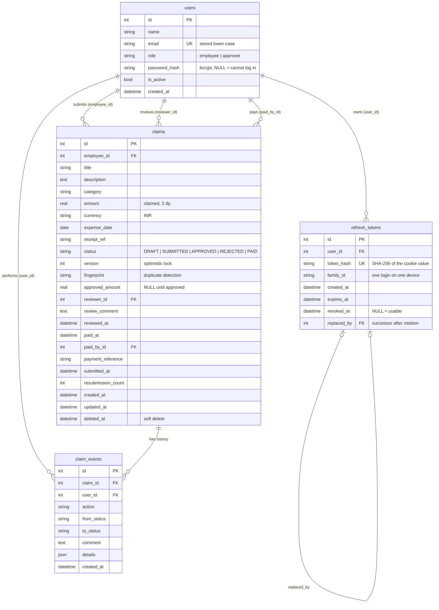
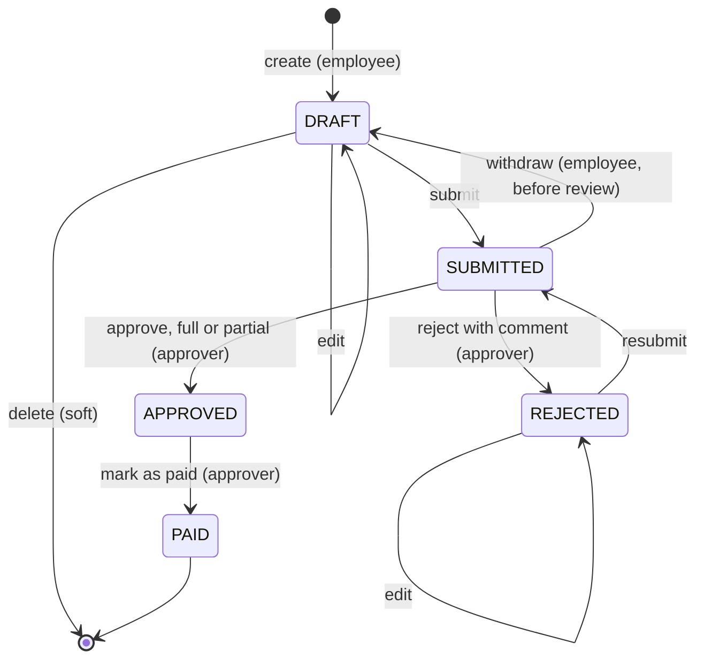

# Data model

SQLite, accessed through SQLAlchemy 2.0 models in [`backend/app/models.py`](../backend/app/models.py).
Tables are created on startup with `create_all` (there are no migrations; see the README's known
limitations). Every timestamp is stored in UTC and returned timezone-aware. Money is a `Decimal` in
Python, stored as a `REAL` rounded to 2 decimals, and always read back as an exact 2-decimal `Decimal`.



## Tables

### `users`

| Column | Type | Notes |
|---|---|---|
| `id` | int PK | |
| `name` | varchar(100) | |
| `email` | varchar(150), unique | Normalised to lower case. The login identifier. |
| `role` | varchar(20) | `employee` or `approver`. Read from the DB on every request, never from the token. |
| `password_hash` | varchar(100), nullable | bcrypt. `NULL` means the account cannot log in. |
| `is_active` | bool, default true | A deactivated user is refused on their next request and cannot refresh. |
| `created_at` | datetime | |

### `refresh_tokens`

| Column | Type | Notes |
|---|---|---|
| `id` | int PK | |
| `user_id` | FK → users | |
| `token_hash` | char(64), unique | SHA-256 of the random token. The raw token exists only in the user's cookie. |
| `family_id` | varchar(32), indexed | All tokens descended from one login. Revoking the family logs out that device. |
| `created_at`, `expires_at` | datetime | Expiry slides forward by `REFRESH_TOKEN_DAYS` on each rotation. |
| `revoked_at` | datetime, nullable | Set when rotated, logged out, or revoked for reuse. |
| `replaced_by` | FK → refresh_tokens, nullable | The successor issued when this token was rotated. Distinguishes "rotated" (reuse is suspicious) from "logged out". |

### `claims`

| Group | Columns | Notes |
|---|---|---|
| Owner | `employee_id` | Indexed. Only employees create claims. |
| Filled in by the employee | `title` (3–120), `description` (≤1000), `category` (fixed list), `amount` (> 0, ≤ 100,000, 2 dp), `currency` (`INR`), `expense_date` (not future, ≤ 90 days old), `receipt_ref` (required on submit above ₹1,000) | Editable while `DRAFT` or `REJECTED`. |
| Workflow | `status`, `version`, `fingerprint` | `status` is indexed. `version` is bumped on every change. |
| Review outcome | `approved_amount`, `reviewer_id`, `review_comment`, `reviewed_at` | Cleared on resubmission; the previous review stays in `claim_events`. `approved_amount < amount` means a partial approval. |
| Payment | `paid_at`, `paid_by_id`, `payment_reference` | Set once by "mark as paid". |
| Bookkeeping | `submitted_at`, `resubmission_count`, `created_at`, `updated_at`, `deleted_at` | `deleted_at` is the soft delete for drafts. |

### `claim_events` (append-only audit log)

One row per create, edit, delete or status change, written **in the same transaction** as the change.

| Column | Notes |
|---|---|
| `action` | `created`, `edited`, `deleted`, `submitted`, `resubmitted`, `withdrawn`, `approved`, `partially_approved`, `rejected`, `paid` |
| `from_status`, `to_status` | `NULL` where they don't apply (for example `edited`). |
| `comment` | The approver's comment on approve or reject. |
| `details` | JSON. For `edited`: `{field: [old, new]}`. For approvals: `{claimed, approved}`. For `paid`: `{amount}`. |
| `user_id`, `created_at` | Who acted, and when. |

The claim detail screen renders this table as the timeline.

## Claim status state machine



The transition table lives in [`services/rules.py`](../backend/app/services/rules.py) (`TRANSITIONS`,
`EDITABLE_STATUSES`, `DELETABLE_STATUSES`). Every change goes through `_apply` in
[`services/claims.py`](../backend/app/services/claims.py).

| Action | Who | From → To | What it does | Event |
|---|---|---|---|---|
| create | owner (employee) | → `DRAFT` | Validates shape and policy (except the receipt rule) and computes the fingerprint. | `created` |
| edit | owner | `DRAFT`/`REJECTED` → same | Saves changed fields only, recomputes the fingerprint, bumps `version`. A no-op edit changes nothing. | `edited` with `{field: [old, new]}` |
| delete | owner | `DRAFT` → (hidden) | Sets `deleted_at`. The row and its history are kept. | `deleted` |
| submit | owner | `DRAFT` → `SUBMITTED` | Re-checks policy, including the receipt rule and the 90-day window, since a draft can age. Sets `submitted_at`. The duplicate index applies from here. | `submitted` |
| resubmit | owner | `REJECTED` → `SUBMITTED` | As submit, plus it clears the previous review fields and increments `resubmission_count`. | `resubmitted` |
| withdraw | owner | `SUBMITTED` → `DRAFT` | Pulls a claim back before anyone reviews it. Clears `submitted_at`. | `withdrawn` |
| approve | approver (not the owner) | `SUBMITTED` → `APPROVED` | `approved_amount` defaults to the claimed amount and must be `0 < x ≤ amount`. Below the claimed amount it is a partial approval, and a comment is required. | `approved` or `partially_approved` with `{claimed, approved}` |
| reject | approver (not the owner) | `SUBMITTED` → `REJECTED` | Comment required (3–500 characters). | `rejected` |
| pay | approver (not the owner) | `APPROVED` → `PAID` | Records `paid_at`, `paid_by_id` and an optional reference. Terminal. | `paid` with `{amount}` |

Anything else is refused with `409 INVALID_TRANSITION`. The server also computes which of these
actions the *current* user may take right now and returns them as `allowed_actions` on every claim.

## Why these structures exist

**The partial unique index (`uq_claim_live_fingerprint`).**
`UNIQUE (employee_id, fingerprint) WHERE status IN ('SUBMITTED','APPROVED','PAID') AND deleted_at IS NULL`.
The fingerprint is `currency|category|amount|expense_date|normalised title`. An application-level
"check, then insert" would race: two concurrent submits can both pass the check. The index makes
the database the referee. It is *partial* so that drafts may look alike while being prepared, a
rejected claim does not block a fresh, corrected one, and a deleted draft frees its fingerprint.
When it fires, the API returns `409 DUPLICATE_CLAIM`.

**The `version` column.**
Optimistic locking. Every write is `UPDATE … WHERE id = ? AND version = ? AND status IN (allowed)`
and bumps `version`. If the row changed between our read and our write, zero rows match, and the
request fails with `409 CONCURRENT_UPDATE` instead of overwriting someone else's decision. Clients
can also send `expected_version` (the version on their screen) and get `409 STALE_VERSION` when the
page is out of date. An approver looking at an old copy cannot approve a claim the employee has since changed.

**Soft delete (`deleted_at`).**
Deleting a draft hides it but keeps the row, so its `claim_events` history (which references it) stays
intact and auditable, and the "deleted" action itself is recorded. Only drafts can be deleted. Once
submitted, a claim is a business record.

**The append-only `claim_events` table.**
The brief asks to "maintain sufficient history". Status columns on `claims` show only the *current*
state, and a resubmission deliberately clears the previous review. The event log keeps every step:
who did it, when, the old and new values of each edited field, and every review comment across
rejection and resubmission rounds. It is written in the same transaction as the change, so history
can never disagree with the claim. Nothing updates or deletes event rows.

**`refresh_tokens` with families.** See [DESIGN_DECISIONS.md](DESIGN_DECISIONS.md#authentication).

## API error codes

Every error has the same shape:

```json
{ "error": { "code": "STALE_VERSION", "message": "Human-readable sentence.", "fields": { "amount": "per-field message" } } }
```

| HTTP | `code` | When |
|---|---|---|
| 401 | `UNAUTHORIZED` | No `Authorization: Bearer` header. |
| 401 | `INVALID_TOKEN` | Bad signature, wrong algorithm, `alg: none`, missing claims, unknown or deactivated user. |
| 401 | `TOKEN_EXPIRED` | Access token past its `exp`. The frontend refreshes and retries. |
| 401 | `INVALID_CREDENTIALS` | Login failed. Same response for an unknown email, a wrong password and a deactivated account. |
| 401 | `INVALID_REFRESH_TOKEN` | Refresh cookie missing, unknown, expired or revoked. |
| 401 | `REFRESH_TOKEN_REUSED` | A rotated refresh token was replayed after the grace window. The whole family is revoked. |
| 403 | `FORBIDDEN` | Wrong role, or an approver acting on their own claim. |
| 403 | `CSRF_CHECK_FAILED` | `/api/auth/refresh` or `/logout` called without `X-Requested-With`. |
| 404 | `NOT_FOUND` | Unknown route, or a claim you may not see. Drafts are invisible to approvers, and other employees' claims are invisible to employees. "Not found" deliberately does not reveal that the claim exists. |
| 409 | `INVALID_TRANSITION` | Action not allowed from the current status (approve twice, pay before approval, edit after submit, …). |
| 409 | `STALE_VERSION` | `expected_version` does not match. Someone changed the claim since you loaded it. |
| 409 | `CONCURRENT_UPDATE` | Lost a race inside the same instant (two approvers, double click). |
| 409 | `DUPLICATE_CLAIM` | You already have an active claim with the same category, amount, date and title. |
| 422 | `VALIDATION_ERROR` | Shape or policy violations. `fields` names each bad field. |
| 429 | `TOO_MANY_ATTEMPTS` | Login throttled. Includes a `Retry-After` header. |
| 500 | `INTERNAL_ERROR` | Unexpected error (logged server-side, with no details leaked). |
